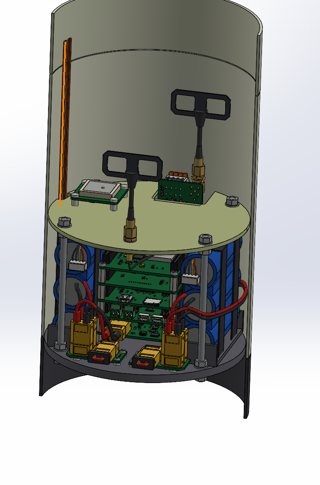
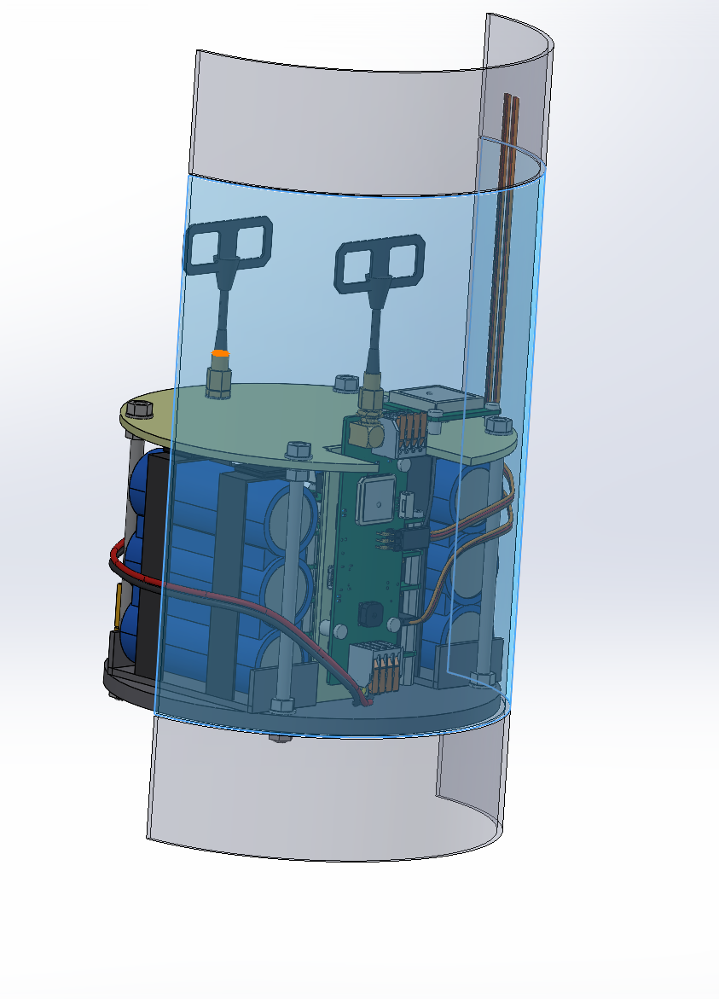
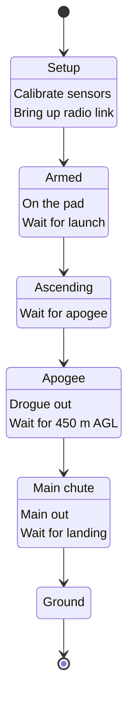
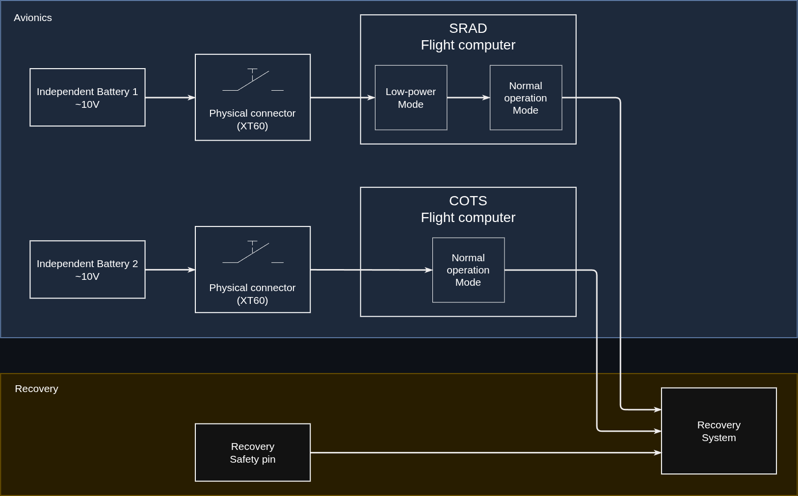
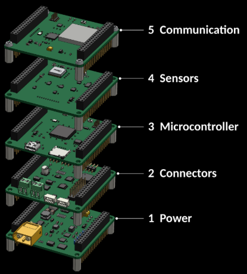
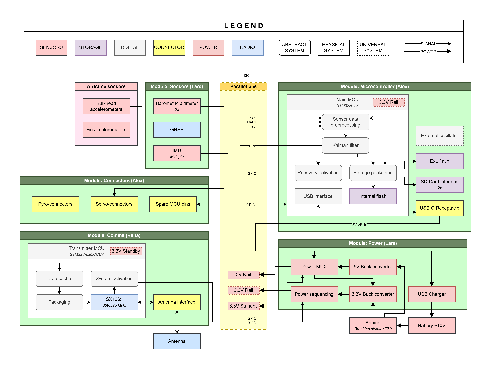

# Avionics WIKI
**Authors: Alexander Svarthaugen**

Welcome to USN Horizon's avionics repository for software and hardware. This document gives a structured overview of the whole avionics system and works as a look-up manual for all the documentation and resources the project needs. If you are looking for something specific, go to the [table of contents](#table-of-contents).

Members who want to add to the wiki should read the [documentation standard](#documentation-standard) and the [contributing to the wiki](#contributing-to-the-wiki) section.
The wiki is still under development. Report anything wrong or out of date when you find it, so the documentation for the project stays good, tidy and accurate.
The avionics team and the avionics lead are responsible for keeping the wiki up to date.

## Table of contents
- [System description](#system-description)
    - [Requirements](#requirements)
    - [System data](#system-data)
    - [Wiring diagram](#wiring-diagram) #Missing
    - [Coordinate system](#coordinate-system) #Missing
    - [Flight states](#flight-states)
- [Components](#components)
    - [SRAD flight computer](#srad-flight-computer)
    - [CATS Vega](#cats-vega)
    - [Arming](#arming)
    - [Ground station](#ground-station)
- [Hardware](#hardware)
    - [Flight computer board](#flight-computer-board)
    - [Ground station hardware](#ground-station-hardware)
- [Software](#software)
    - [Flight computer firmware](#flight-computer-firmware)
    - [Ground station software](#ground-station-software)
    - [Simulation](#simulation) #Missing
- [Interfaces](#interfaces)
    - [Radio link](#radio-link)
    - [Telemetry messages](#telemetry-messages) #Missing
- [Testing](#testing)
- [Procedures](#procedures) #Missing
- [Design reviews](#design-reviews)
- [Documentation](#documentation)
    - [Documentation standard](#documentation-standard)
    - [Where things live](#where-things-live)
    - [Contributing to the wiki](#contributing-to-the-wiki)

## System description
The avionics is everything electronic that flies in the rocket, and everything that follows it from the ground. For EuRoC 2027 that is our own SRAD flight computer with a CATS Vega as an independent backup, a ground station, the telemetry link between them, and a hardware in the loop (HIL) simulator that tests the flight software against simulated flights before it ever flies.

PCBs are designed in Altium Designer and KiCad, and wiring in E3.series. KiCad is in use because we could not get the Altium collaboration set up. The flight firmware is written in C++ and runs on FreeRTOS. See the [repository README](../README.md) for how the repository is organized.

Budget for the avionics bay, as presented at the internal PDR: about 300 mm of the rocket's length (±70 mm), 150 mm wide (±50 mm) and 1.5 kg (±0.5 kg).

<p align="center">
  
  
  <br>
  <em>Concept model of the avionics bay (SolidWorks), shown at the internal PDR.</em>
</p>

At the Flight Readiness Review, EuRoC inspects the avionics outside the body tubes, so the bay has to come out of the rocket. The ground station is inspected too, as SRAD ground support equipment (CR 7.3).

### Requirements
The EuRoC requirements that drive the avionics design, in short. The full list, with the exact wording, is in the EuRoC requirements checklist on Teams (see [Where things live](#where-things-live)).

| Requirement | What it asks for | Our design |
| --- | --- | --- |
| RQT-0240, 0250 | Two fully separate recovery electronics chains, each with its own battery. At least one of them is a COTS flight computer. | SRAD flight computer and CATS Vega, each with its own battery and its own recovery servo. |
| RQT-0260 to 0280 | Switches and connectors that are operated by hand sit on the skin or behind an access panel, can be reached from the ground with the rocket on the rail, and are on the side opposite the rail. | Arming plugs behind a service hatch on the side opposite the rail. Position to be agreed with Airframe. |
| RQT-0300 | No lithium polymer batteries on board, and no lithium batteries that can't be recharged. | 3S LiFePO4, 9.9 V nominal. |
| RQT-0310, 0320 | Batteries can be reached from the ground with the rocket on the rail, and last at least 6 h on the rail. | Battery access through the service hatch. Low power mode while waiting. Runtime not verified yet. |
| RQT-0350, 0370 | The drogue deploys at or near apogee, and the main parachute no higher than 450 m above ground. | Drogue at apogee and main at 450 m above ground, see [Flight states](#flight-states). Open: how far below 450 m to trigger, to leave room for altitude error. |
| RQT-0430 to 0470 | An unmodified CATS Vega with the EuRoC firmware and an assigned call sign, used with the CATS ground station. Its switches follow RQT-0260 to 0280. | The CATS Vega flies as tracker and backup recovery computer. The CATS ground station is carried in our ground station case. |
| RQT-0480, 0490 | Safety critical wiring is tied down with slack at every connection, and every connection survives a tug test. | Open. |
| RQT-0510 | Thermal test of the electronics with a signed report, cooling or venting, and at least one temperature sensor monitored. | Open: test method not chosen. |
| RQT-0520 | The recovery system is tested before EuRoC. In a ground test, the sensor electronics take part and are triggered by simulated flight conditions. | Planned, see [Testing](#testing). |
| RQT-0530 to 0550 | Energetics stay safed until the rocket is in launch position. Arming features follow RQT-0260 to 0280 and sit on the airframe. | See [Arming](#arming). |
| RQT-0780 to 0820 | A 360° radio window at least two calibers long, not carbon fiber, with the antennas in the middle of it, away from wiring and metal. | Antennas in a glass fiber section of the airframe. Position to be agreed with Airframe. |
| RQT-0650 to 0700 | Rules for active flight control. | Not used. There is no active flight control in the EuRoC 2027 scope. |

### System data
Key numbers for the system data appendix of the EuRoC Technical Report (CR A7). Fill in the missing ones as they are decided or measured.

| Item | Value |
| --- | --- |
| SRAD flight computer | STM32H753, with an STM32WLE5 for the radio |
| Batteries | 3S LiFePO4, 9.9 V nominal, one per recovery chain |
| Standby time on the rail | #Missing (EuRoC requires at least 6 h) |
| Telemetry frequency | 869.525 MHz, in the 869.40 to 869.65 MHz part of EU868 |
| RF power | #Missing (the band allows up to 500 mW) |
| Airtime | At most 10 % |
| Data rate | #Missing |
| Range | #Missing |
| Antennas | Rocket: #Missing. Ground station: two 868 MHz omni antennas on a tripod. |
| CATS Vega link | 2.4 GHz, at most 100 mW (EuRoC rules, appendix D2) |
| Avionics bay | About 300 mm long and 150 mm wide, 1.5 kg (budget) |

### Wiring diagram
#Missing

The full electrical diagram of the avionics, from the batteries through the arming plugs and flight computers to the servos and antennas. EuRoC wants an electrical system diagram in the Technical Report (CR A4).

### Coordinate system
#Missing

Defines which way the axes point, so that the sensor data, the Kalman filter, telemetry, the ground station and the simulations all mean the same thing. It covers:
- the body frame, fixed to the rocket
- how each IMU and accelerometer is mounted relative to the body frame
- the world frame at the launch site, for example ENU (east, north, up)
- units and signs, such as which way is positive for vertical velocity

### Flight states
The flight software moves through these states. The transitions are the ones presented at the internal PDR, and the state names come from [#13](https://github.com/USN-Horizon/Avionics/issues/13). Recovery is deployed on the transitions out of *Ascending* and *Apogee*.



| State | Ends when | Action |
| --- | --- | --- |
| Setup | The sensors are initialised and calibrated, and the radio link is up. | |
| Armed | The vertical velocity crosses the launch threshold above zero. | |
| Ascending | The vertical velocity crosses a threshold below zero: apogee has passed. See [apogee detection](#flight-computer-firmware). | Deploy the drogue when leaving the state. |
| Apogee | The altitude is below 450 m above ground. | Deploy the main parachute when leaving the state. |
| Main chute | The velocity is no longer changing. | |
| Ground | This is the last state. | Proposed: send less data and act as a beacon. |

*Armed* is the software's name for waiting on the pad. It is not the same as armed in EuRoC's sense, see [Arming](#arming).

Open: the launch detection thresholds and how false triggers are avoided, how far below 450 m the main parachute is triggered (RQT-0370 sets 450 m above ground as the highest allowed), and how the software finds its state again after a reset in flight.

## Components
### SRAD flight computer
Our own flight computer, designed by the team for EuRoC 2027. It reads the sensors, tracks the flight state, deploys recovery and sends telemetry to the ground station. It is a stack of small modules around an STM32H753, see [Flight computer board](#flight-computer-board) and [Flight computer firmware](#flight-computer-firmware).

### CATS Vega
A COTS flight computer that flies alongside the SRAD flight computer as an independent backup, with its own battery. EuRoC requires it, unmodified and running the EuRoC firmware, for official altitude logging and tracking, together with the CATS ground station that receives it (RQT-0430 to 0460). We have two, with antennas. The configurations used on Ratatoskr are in [archived/2025-2026-ratatoskr/Ratatoskr-CATS-Vega-configurations](../archived/2025-2026-ratatoskr/Ratatoskr-CATS-Vega-configurations/).

### Arming
In EuRoC's terms, a recovery system is *safed* while two separate events are needed to release it, and *armed* when one event is enough. Arming features must be physical, on the airframe, and reachable from the ground with the rocket on the rail (RQT-0530 to 0550, RQT-0260 to 0280).

Our recovery is released by servos that start the CO2 release, one servo per recovery chain, driven by the SRAD flight computer and the CATS Vega. The arming hardware as planned:
- A safety pin mechanically blocks both servos until it is pulled.
- Each chain has its own battery and its own XT60 arming plug between the battery and the flight computer. Power stays off during transport and assembly.
- On the SRAD side, the plug sits on a small arming board with three XT60 connectors: battery in, flight computer out, and the arming plug that completes the circuit.
- The plugs sit behind a service hatch on the side opposite the rail. Their exact position is to be agreed with Airframe.
- Once the plug is in, only the communication module of the SRAD flight computer runs, on the 3.3 V standby rail. The rest stays off until the ground station tells it over radio to power up. The radio cannot replace the physical arming.



*The two independent recovery chains, each with its own battery and arming plug, and the safety pin, as presented at the internal PDR.*

We chose a physical plug over a magnetic switch, because it is simpler, more reliable and easier to disarm.

Open:
- Which step counts as arming in EuRoC's terms, and the arming and disarming sequence (see [Procedures](#procedures)).
- How the rocket is made safe again after it has been armed.

### Ground station
A station in a hard case, with its radio on a tripod. It talks to the rocket over radio, logs every flight and serves live data to the team's laptops and phones at the launch site. It also carries the CATS ground station. See [Ground station hardware](#ground-station-hardware) and [Ground station software](#ground-station-software).

## Hardware
### Flight computer board
The SRAD flight computer is a stack of small boards, one function each. Connectors between the boards carry a parallel bus with the signals and the power rails. The last SRAD flight computer failed to boot, and that one fault retired the whole board. With modules, a fault can be found and the module replaced, and each module can be developed and tested on its own. The stack is estimated at about 6 × 6 × 6 cm.

<p align="center">
  
  <br>
  <em>Concept render of the stack, shown at the internal PDR. The boards are placeholders.</em>
</p>



*Block diagram of the flight computer, November 2026. It will change as the design develops.*

| Module | Does | Parts and status |
| --- | --- | --- |
| Microcontroller | Runs the flight software: preprocesses the sensor data, runs the Kalman filter, triggers recovery and logs the data. | STM32H753 with an external oscillator. Logs to two SD cards, external flash and the internal flash. USB-C for talking to the MCU and for charging. |
| Communication | Radio link to the ground station. Caches and packs the data it gets from the microcontroller, and wakes up the rest of the flight computer when the ground station tells it to. | STM32WLE5, which has a LoRa radio (SX126x) built in. 869.525 MHz, see [Radio link](#radio-link). Runs on the standby rail. |
| Sensors | Position and orientation. | Two barometric altimeters, several IMUs and a GNSS receiver. Accelerometers on the bulkheads and fins are wired to the microcontroller separately, over I2C. Parts not chosen yet. |
| Power | Turns the battery voltage into the system voltages. | 3S LiFePO4, 9.9 V nominal. Buck converters for the 5 V and 3.3 V rails. A 3.3 V standby rail stays on all the time and powers the communication module, which switches the main rails on. A USB charger, and a power multiplexer so the flight computer can also run from USB. |
| Connectors | Connections to the rest of the rocket. | Servo connectors for recovery, pyro connectors and spare MCU pins. |
| Arming | Breaks the circuit between the battery and the flight computer. | Separate board with three XT60 connectors, see [Arming](#arming). |

Open:
- The connector between the boards. A backplane with PCIe connectors was dropped, as they are not made for vibration. To fit all the signals, the stack needs a pitch of about 1 to 1.27 mm.
- Mounting that holds up to launch loads and vibration.
- Which sensor parts, and whether accelerometers on the fins are realistic.
- Whether the board keeps the pyro connectors. The recovery release planned for EuRoC 2027 uses servos.

### Ground station hardware
The ground station has two parts, joined by one Ethernet cable that carries both data and power:
- **Tripod:** a stand of about 2 m with two 868 MHz omni antennas and the radio module in a weatherproof box. A directional panel antenna is being considered as one of the two.
- **Case:** an IP65 hard case, 41 × 32 × 18 cm. A 14 inch 1080p IPS screen in the lid, a keyboard deck, the computer, two battery packs under 100 Wh each (so they can travel by air), and the CATS ground station.

The payload team's radio gets its own box on the tripod, separate from the avionics radio module.

The first version uses bought boards. Our own boards replace them later:

| Part | First version | Later |
| --- | --- | --- |
| Computer | Raspberry Pi 5, 16 GB | Compute module on our own carrier board |
| Radio | NUCLEO-U575ZI-Q with an SX1262 radio | Our own board with two radios, in the tripod box |
| Power | Bought battery packs | Our own power board |

Power estimate, not measured yet, from the two packs (about 190 Wh in total):

| Mode | Draw | Runtime |
| --- | --- | --- |
| Full load | about 30 W | about 6 h |
| Normal | about 19 W | about 10 h |
| Saving, screen off | about 9 W | about 21 h |

## Software
### Flight computer firmware
Code: [software/flight-computer](../software/flight-computer/)

- C++ on FreeRTOS, built with PlatformIO.
- Target: STM32H753. Development is on a NUCLEO-H753ZI. The first FreeRTOS tests ran on an STM32F411 Black Pill, which is what `software/flight-computer` builds for today.
- The radio firmware runs on the STM32WLE5 of the communication module. Development is on Wio-E5 mini boards.

The firmware reads the sensors, preprocesses the data and runs it through a Kalman filter, moves through the [flight states](#flight-states), and deploys the drogue at apogee and the main parachute at 450 m above ground. It logs everything to the SD cards and flash, and passes the data over SPI to the communication module, which sends it to the ground station.

Apogee is detected from the filtered vertical velocity: it has changed sign and stayed near zero for a set time, so one bad reading can't trigger it. The proposal is within ±5 m/s for at least one second. Backup checks (altitude change, tilt, a timer) are still being discussed.

Programming rules (preliminary):
- No dynamic allocation. Use the static versions of the FreeRTOS functions.
- No compiler warnings. Build with `-Werror`.
- Use asserts, and keep them on in flight. If something is wrong, we want the program to stop rather than run on in a bad state, where the worst case is deploying recovery too early.

Open: the FreeRTOS task and queue layout, worked out in [#13](https://github.com/USN-Horizon/Avionics/issues/13).

### Ground station software
Code: [software/ground-station](../software/ground-station/)

Three parts run on the ground station computer:
- **Radio program (Python):** reads the radio module, checks and decodes each message, passes the data to the web server and logs it. It also sends commands to the rocket. Because it is separate, the server doesn't depend on the hardware and can be tested with simulated data.
- **Web server (Python, FastAPI):** serves the interface as a web page to any laptop or phone on the station's network. The radio program updates its data with HTTP PUT requests. Updates go out to the browsers in real time over WebSockets, and commands from the browsers come back the same way.
- **Web page (HTML, CSS and JavaScript, no framework):** one page with tabs, for example for avionics and payload. It asks for all current data when it loads, and reconnects by itself when the connection drops.

Open: the log format, and the requirements for each part.

### Simulation
#Missing

The plan is a hardware in the loop (HIL) test rig: the flight software reads emulated sensors that play back a simulated flight, so a whole flight can be tested on the bench. [Renode](https://renode.io/) is being looked at for running the firmware without hardware. The rig should also cover the recovery ground test and the test of the SRAD flight computer that EuRoC asks for, see [Testing](#testing).

## Interfaces
### Radio link
- EU868 band, between 869.40 and 869.65 MHz: up to 500 mW and at most 10 % airtime (6 minutes per hour). That leaves room for one 250 kHz channel, at 869.525 MHz.
- LoRa, both ways: telemetry from the rocket, commands from the ground station.
- The CATS Vega has its own 2.4 GHz link to the CATS ground station.
- The payload team also plans to use LoRa (SX126x). Frequencies, power and antenna placement are coordinated with them.

### Telemetry messages
#Missing

Not decided yet: our own protocol or MAVLink, the message set, whether each packet carries all the data at a fixed interval (the current proposal), error checking (CRC and FEC) and encryption. The proposal is to repeat the flight state regularly, not only when it changes, so that one lost packet doesn't hide a state change. The Ratatoskr MAVLink dialect is in [archived/2025-2026-ratatoskr/proto](../archived/2025-2026-ratatoskr/proto/) for reference.

## Testing
- **Hardware in the loop:** see [Simulation](#simulation). The external concept review advised running it again and again through the project, together with small test flights, rather than as a single milestone.
- **Avionics Testing Rocket:** a small 3D printed rocket for flying the flight software on a small test board before the real flight computer is built. See [testing/testing rocket](../testing/testing%20rocket/).
- **Required by EuRoC:** a thermal test of the electronics with a signed report (RQT-0510), the CATS links shown at the Flight Readiness Review (RQT-0440), and at least 6 h on the rail (RQT-0320).
- **Recovery ground test (RQT-0520):** the flight computers take part, triggered by simulated flight conditions. For the Technical Report, the whole chain from the SRAD flight computer to the recovery actuators has to be tested. EuRoC recommends a vacuum chamber for the barometers and emulated data for the IMUs (CR A8).
- **Vibration and shock:** needed, method not chosen yet. #Missing

## Procedures
#Missing

The assembly, arming and launch checklists. EuRoC requires them to include how to disarm and make the rocket safe when something goes wrong, and the time for each step from wet rehearsals (CR A12).

## Design reviews
| Review | Date |
| --- | --- |
| Concept review, internal | 12 Oct 2026 |
| Concept review, external | 30 Oct 2026 |
| Preliminary design review (PDR), internal | 16 Nov 2026 |
| PDR, external | planned for 11 Jan 2027 |

The later milestones (concept freeze, interface freeze and the critical design review) are in the Horizon plan on Teams. The slides and the review feedback are in Teams, see [Where things live](#where-things-live).

## Documentation
### Documentation standard
Work must be documented in the set format once a board, program or component is taken into use. Write the documentation as if the reader has no earlier insight into how your board or code works, but understands the basics of the tools and languages (C/C++, Git, reading a schematic).

Below is a short checklist of **minimum requirements** for documenting software:
- Inputs and outputs, including message types, with links to [Telemetry messages](#telemetry-messages) where relevant
- Commands or scripts needed to build, flash and run it
- A user and run guide. Describe what someone needs to understand how it works as a whole
- Dependencies. Describe the libraries, toolchain versions and other programs it needs to run

And for hardware:
- Purpose and block diagram
- Connectors and signals (pinout)
- Power: inputs, rails and expected current draw
- Bring-up and test status

Larger parts such as the flight state machine, the telemetry link and the sensor drivers need more thorough documentation, with setup instructions, diagrams, pictures and so on.

As you know, we don't recruit kindergarteners. So write documentation for a reader who knows the basic system, but not your part of it. Basic C/C++ and electronics don't need explaining beyond what comes naturally.

A few more rules:
- Anything not decided or documented yet is marked `#Missing`, both in its section and in the table of contents. Remove the mark when you write the section.
- Update the wiki in the same pull request as the change it describes.
- Put images in `docs/images/` as PNG or SVG. GitHub can't show a PDF inside the page, only link to it. Block diagrams and state machines can be drawn in [Mermaid](https://mermaid.js.org/), which GitHub renders.
- Link to datasheets on the manufacturer's site instead of committing them.
- Don't commit the EuRoC documents or copy their figures, as they may not be reproduced without permission. Link to the [EuRoC website](http://www.euroc.pt) instead, and refer to requirements by their ID.
- This repository is public. No prices, sponsor details, personal information or passwords.
- Drafts, meeting notes and work in progress don't go here. Keep them in the master document on Teams or in the task's issue until they are settled.

### Where things live
| What | Where |
| --- | --- |
| Finished documentation | This wiki |
| Drafts and working notes | The master document in the Avionics channel on Teams, under EuRoC Technical documentation |
| Meeting notes | The Avionics channel on Teams, under 2026 Weekly meetings, written with the agenda template |
| Tasks | The [Avionics 2026-2027](https://github.com/orgs/USN-Horizon/projects/4) project on GitHub |
| EuRoC requirements checklist, the Horizon plan, review slides and review feedback | The General channel on Teams |
| Announcements | Teams |
| Everyday discussion | Discord |

Written communication, documentation and shared project material are in English.

### Contributing to the wiki
To contribute to the wiki, follow these steps:
1. Do all work in the [Avionics repository](https://github.com/USN-Horizon/Avionics), on a branch, as described in [CONTRIBUTING.md](../CONTRIBUTING.md).
2. Find or add the section in this document that matches the board, program or component you want to document.
3. Write an explanation of what it does in this document, and link to the code or design files you are documenting.
4. Open a pull request. The avionics lead reviews it.

You can make links in .md files like this:
```markdown
[Visible text](#link)
```

> [!IMPORTANT]
> If you have any questions about this document, contact the avionics lead (as of November 2026: **Alexander Svarthaugen**).
