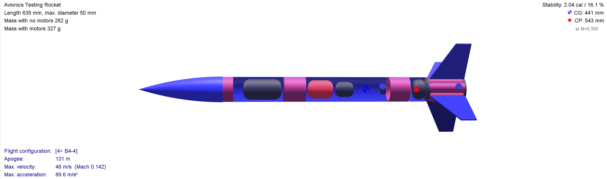
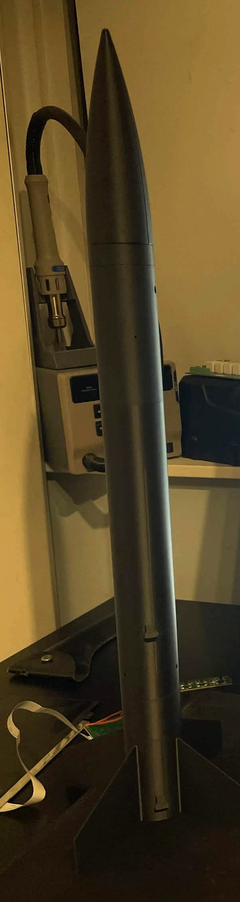

# Avionics Testing Rocket

A small 3D printed rocket for testing the flight software in flight, on a small test board, before the real flight computer is built. The first flights are planned after the exams, first with nothing inside, then with a parachute and small electronics.

*The design in OpenRocket, with the simulated flight.*

- Everything is 3D printed, including the launch rail. Only the motors and basic consumables are bought.
- Four motor mounts, 18 Ns total impulse: under the 20 Ns limit for flying as a model rocket without a permit.
- Designed in OpenRocket and SolidWorks. The parts are exported here as STEP files.

| Item | Value |
| --- | --- |
| Length | 635 mm |
| Diameter | 50 mm |
| Mass | 262 g without motors, 327 g with motors |
| Motors | 4 × B4-4 |
| Stability | 2.04 calibers |
| Apogee | 131 m (simulated) |
| Top speed | 48 m/s (simulated) |
| Peak acceleration | 89.6 m/s² (simulated) |

  
   
  <em>The printed rocket.</em>

| Folder | Contents |
| --- | --- |
| [rocket](rocket/) | STEP files: P1 nose, P2 avionics section, P3 ring, P4 recovery tube, P5 fin, P6 motor cover |
| [rail](rail/) | The launch rail. #Missing |
